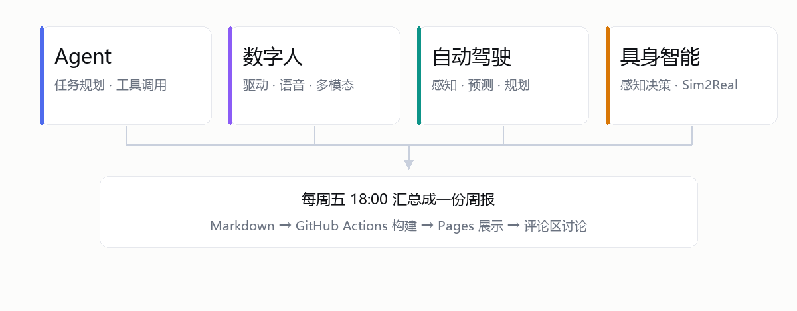

## 学习目标

- 梳理多方向学习路线与复现路径
- 输出统一的周报格式并验证协作流程

*图片示例：图放在 `reports/assets/2026-W43/`，正文用 `assets/…` 相对路径引用，点一下可以放大。*

## 成果总结

### Agent

- 对比了 ReAct 与 Plan-and-Execute 两种代理范式
- 完成一个“检索 + 总结”的工具调用实验

### 数字人

- 调研驱动链路（文本 → 语音 → 表情/口型）的关键模块
- 明确低延迟交互需要优先优化 TTS 推理时间

### 自动驾驶

- 学习端到端与模块化方案的优缺点
- 记录闭环评估中常见误差来源（感知误检、轨迹平滑不足等）

### 具身智能

- 阅读模仿学习与强化学习结合的案例
- 整理“仿真到现实（Sim2Real）”迁移中的关键风险点

## 关键资料

- [ReAct 论文](https://arxiv.org/abs/2210.03629)
- [End-to-End Autonomous Driving Survey](https://arxiv.org/abs/2303.09824)
- [Sim2Real 综述](https://arxiv.org/abs/2009.13303)

## 代码 / 演示链接

- 示例占位：https://github.com/Yang-Shuai666/Physics-AI-Forum

## 问题与讨论点

1. agent 的评估指标如何兼顾“任务成功率”和“调用成本”？
2. 数字人交互中，实时性与表达质量应该如何取舍？
3. 自动驾驶学习是否需要团队统一仿真数据集？
4. 具身智能实验是否先以仿真任务作为每周固定基准？

## 下周计划

- 完成一个可复用的 agent benchmark 模板
- 数字人方向搭建最小可运行语音驱动链路
- 自动驾驶方向复现实验并输出误差分析表
- 具身智能方向确定统一的仿真任务与评价指标
